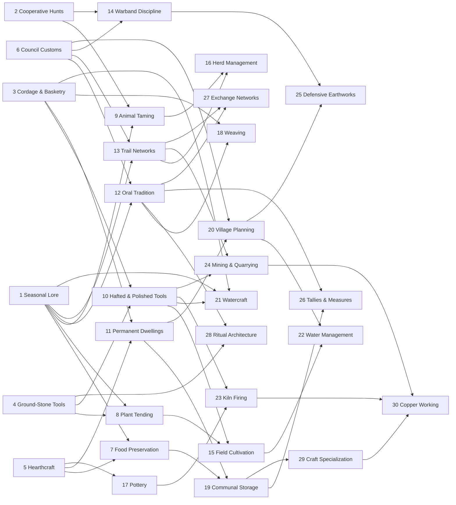

# Tribal-age technology tree

Research date: 2026-08-14

## Decision

Use a **30-node technology web**, not a single historical ladder. The web starts with knowledge that a small camp can deliberately refine and ends at the transition into settled ancient or Chalcolithic societies. A player should normally complete only 16-21 nodes before leaving the age.

The design must not imply that every society moved from hunting to farming, then pottery, then villages in the same order. The archaeological record directly contradicts that sequence:

- Natufian communities harvested wild cereals, used grinding tools and storage pits, and sometimes occupied settlements year-round before clear cereal domestication; domesticated plants and managed sheep/goats also appear as separate later changes in the Levant. [Penn Museum](https://www.penn.museum/sites/expedition/dietary-reconstruction-and-near-eastern-archaeology/)
- The oldest known pottery in China predates agriculture there. [Smithsonian National Museum of Asian Art](https://asia-archive.si.edu/learn/for-educators/teaching-china-with-the-smithsonian/interactives/timelines/timeline-of-chinese-history-art-and-culture/)
- Hunter-gatherers built the monumental enclosures at Gobekli Tepe between 9600 and 8200 BCE. [UNESCO](https://whc.unesco.org/en/list/1572/)
- The Pesse logboat dates to 8040-7510 BCE, so watercraft cannot sensibly be a late farming technology. [Dutch Cultural Heritage Agency](https://mass.cultureelerfgoed.nl/themes/log-boats)
- Jericho was already a substantial permanent settlement with a wall, ditch, and tower in the ninth to eighth millennia BCE. [UNESCO](https://whc.unesco.org/en/list/1687/)

These are earliest surviving examples in particular regions, not universal invention dates. They should guide plausible dependencies and discoveries, never force all cultures onto one chronology.

## What the player already knows

The 10,000 BCE start must not portray humans as technologically blank. Every tribe begins with these unresearched baseline capabilities:

- controlled fire and fire transport;
- knapped stone, bone, and wooden implements;
- basic shelters and clothing;
- foraging, hunting, fishing, and food preparation;
- spoken language, kinship, and customary cooperation;
- simple spears, projectiles, traps, and personal combat.

Research represents making knowledge **reliable, teachable, organized, and scalable**, not a lone genius inventing it for humanity.

## Graph overview

`A + B` means both prerequisites are required. A condition in braces is a discovery opportunity, not a hard prerequisite. The node can always be researched normally.

`Craft Specialization` additionally requires any one demonstrated craft: Pottery, Weaving, or Mining & Quarrying. This is the only `anyOf` prerequisite in the first implementation.

## Cost and pacing

Use integer **Knowledge** costs. Do not tie technology completion directly to a calendar year; societies in different environments and campaigns should diverge.

| Tier | Base cost | Target time at baseline output | Purpose |
|---|---:|---:|---|
| I - Camp practice | 45 | 3-5 real minutes | Six understandable opening choices |
| II - Reliable tradition | 90 | 6-9 minutes | Establish the tribe's direction |
| III - Organized practice | 170 | 10-14 minutes | Add settlement and production systems |
| IV - Institutions | 300 | 15-22 minutes | Specialization and regional power |
| V - Breakthrough | 520 | 25-35 minutes | Rare end-of-era capability |

Balance Knowledge income so that the first choice completes quickly and a typical tribal age lasts roughly 2-3 hours at standard speed. The player should not research the entire web. Faster game-speed settings scale all costs with one rational integer multiplier.

Discoveries award `35%` of a node's base cost as immediate progress, once. Cultural familiarity may provide up to `20%` starting progress. Knowledge diffusion from contacted tribes may provide `10%` from the first independent source and `5%` from the second. Total non-research progress is capped at `60%`, so every technology still requires an intentional investment.

## The 30 technologies

### Tier I - Camp practice (45 Knowledge each)

| ID | Technology | Main unlock | Discovery condition |
|---|---|---|---|
| N01 | **Seasonal Lore** | Seasonal forecast, migration plan, and visible seasonal reliability in terrain tooltips | Observe one complete local seasonal cycle, or scout through three distinct ecological zones |
| N02 | **Cooperative Hunts** | Hunting-party formation, drive-hunt order, lower injury risk against large game | Complete a hunt involving at least three hunters |
| N03 | **Cordage & Basketry** | Carrying baskets, nets, snares, and basket storage; better carried load | Gather usable fibre or reeds and carry a full expedition load home |
| N04 | **Ground-Stone Tools** | Querns, mortars, durable ground edges, faster seed and plant processing | Process a large quantity of wild seed or find suitable abrasive stone |
| N05 | **Hearthcraft** | Maintained hearth, improved cooking, warmth, smoking experiments, and safer campfires | Maintain an occupied camp through several cold nights or cook repeated communal meals |
| N06 | **Council Customs** | Council gathering, negotiated camp decisions, formal diplomacy, and shared-work orders | Hold a gathering after first contact or resolve an internal dispute without violence |

### Tier II - Reliable tradition (90 Knowledge each)

| ID | Technology | Prerequisites | Main unlock | Discovery condition |
|---|---|---|---|---|
| N07 | **Food Preservation** | N01 + N05 | Drying rack/smokehouse, preserved expedition rations, slower spoilage | Lose Food to spoilage or preserve a seasonal surplus through a lean period |
| N08 | **Plant Tending** | N01 + N04 | Managed wild plots, selective harvesting, protection of useful plants | Harvest the same wild plant stand in three seasons |
| N09 | **Animal Taming** | N01 + N02 | Capture/corral order and evaluation of locally manageable species | Keep captured young or a small compatible group alive through a season |
| N10 | **Hafted & Polished Tools** | N03 + N04 | Polished axe/adze recipes, efficient tree work, faster durable construction | Fell and shape a substantial timber using locally suitable toolstone |
| N11 | **Permanent Dwellings** | N03 + N05 | Hut upgrade, resident work assignments, and permanent-camp status | Occupy one camp for 60 days and maintain at least three shelters |
| N12 | **Oral Tradition** | N01 + N06 | Lorekeeper role, less Knowledge loss after disruption, faster teaching and diffusion | A scout returns with new information and recounts it at a council |
| N13 | **Trail Networks** | N01 + N06 | Repeated routes consolidate faster into beaten paths; route logistics and safer travel | Travel the same land corridor repeatedly for a cumulative 50 km |
| N14 | **Warband Discipline** | N02 + N06 | Warband formation, rally point, controlled raid, morale/cohesion bonuses | Repel an attack or complete a coordinated hunt without a unit breaking formation |

### Tier III - Organized practice (170 Knowledge each)

| ID | Technology | Prerequisites | Main unlock | Discovery condition |
|---|---|---|---|---|
| N15 | **Field Cultivation** | N08 + N10 | Placeable fields; sowing and harvest cycle driven by soil, moisture, season, and labor | Successfully harvest a managed plot on suitable soil |
| N16 | **Herd Management** | N09 + N13 | Reproducing herd entity, grazing route, culling, and seasonal herd movement | Keep a managed herd alive through one full migration or lean season |
| N17 | **Pottery** | N05 | Clay pit, hand-built vessels, improved cooking and household storage | Work usable clay or sediment near a maintained hearth |
| N18 | **Weaving** | N03 + N12 | Spinning/weaving workspace, textile clothing, improved nets and carrying gear | Produce repeated cordage batches and maintain a dedicated craft worker |
| N19 | **Communal Storage** | N07 + N11 | Storehouse/granary, pooled reserve policy, and reduced famine volatility | Hold more Food than households can privately store through a season |
| N20 | **Village Planning** | N06 + N11 | Camp-to-village layout, work zones, expanded building limit, and shared infrastructure | Maintain five permanent structures or reach 150 population |
| N21 | **Watercraft** | N01 + N03 + N10 | Raft/logboat, river crossing, waterborne scouting, wider fishing and local cargo reach | Establish a camp beside navigable water and gather suitable timber or reeds |
| N28 | **Ritual Architecture** | N04 + N12 | Communal shrine/monument, major influence projection, gatherings, and visitor prestige | Complete several large communal gatherings or move a megalithic stone |

Ritual Architecture deliberately does **not** require agriculture or a village. Gobekli Tepe demonstrates why such a dependency would be historically misleading. [UNESCO](https://whc.unesco.org/en/list/1572/)

### Tier IV - Institutions (300 Knowledge each)

| ID | Technology | Prerequisites | Main unlock | Discovery condition |
|---|---|---|---|---|
| N22 | **Water Management** | N15 + N20 | Wells/cisterns where geology permits, diversion ditches, drainage, and small irrigation works | Endure crop water stress or maintain fields beside seasonal water |
| N23 | **Kiln Firing** | N10 + N17 | Controlled kiln, durable pottery, fired clay components, higher fuel demand | Successfully fire several pottery batches and sustain a high-temperature burn |
| N24 | **Mining & Quarrying** | N10 + N13 | Toolstone mine, stone quarry, prospecting, and bulk extraction worksite | Exhaust an important surface source or identify a subsurface seam |
| N25 | **Defensive Earthworks** | N14 + N20 | Ditch, berm, palisade, watch platform, and defensive rally plan | Discover a hostile settlement or survive a serious raid |
| N26 | **Tallies & Measures** | N12 + N19 | Auditable inventories, work quotas, fair division policy, and better construction estimates | Manage three stockpiles through a shortage or conduct repeated large exchanges |
| N27 | **Exchange Networks** | N12 + N13 | Recurring barter routes, guest-right agreements, prestige-good trade, and Knowledge diffusion | Meet two communities or complete two reciprocal exchanges |
| N29 | **Craft Specialization** | N19 + any one of N17/N18/N24 | Dedicated workshop and craft role, higher-quality Tools, batch production, and specialist apprenticeship | Keep at least 10% of adults in one craft or complete a large standardized batch |

Watercraft is not required for Exchange Networks, but owning it gives a discovery opportunity and increases route range on navigable water. Deep flint mines and wide distribution networks are attested at Spiennes and Krzemionki, supporting late tribal mining as a specialized economic path rather than a generic early action. [UNESCO: Spiennes](https://whc.unesco.org/en/list/1006/), [UNESCO: Krzemionki](https://whc.unesco.org/en/list/1599/)

### Tier V - Breakthrough (520 Knowledge)

| ID | Technology | Prerequisites | Main unlock | Discovery condition |
|---|---|---|---|---|
| N30 | **Copper Working** | N23 + N24 + N29 | Copper workshop, native-copper cold working/annealing, experimental ore smelting, copper ornaments and limited soft tools | Possess native copper or copper mineral from local prospecting or trade and operate a kiln |

Copper Working is an era-edge technology, not Bronze Working. The secure Belovode evidence places fully developed copper smelting in the 49th century BCE and supports treating it as a late regional breakthrough. [UCL](https://www.ucl.ac.uk/social-historical-sciences/news/2022/jan/new-monograph-rise-metallurgy-eurasia)

## Leaving the tribal age

Age transition should be a **societal achievement**, not “research every technology.” A tribe becomes eligible after completing at least 14 technologies, including two Tier IV technologies, and one of these paths:

| Path | Required technologies | World-state requirement | Likely evolution |
|---|---|---|---|
| Agrarian village | N15 Field Cultivation, N19 Communal Storage, N22 Water Management | Sustain a permanent settlement from stored and cultivated Food for two harvest cycles | Settled agrarian society |
| Pastoral confederation | N13 Trail Networks, N16 Herd Management, N27 Exchange Networks | Maintain two viable herds and formal relations with two tribes | Mobile pastoral polity |
| Communal center | N20 Village Planning, N26 Tallies & Measures, N28 Ritual Architecture | Reach a regional influence/prestige threshold with a stable permanent settlement | Temple/assembly-centered society |
| Metallurgical center | N23 Kiln Firing, N24 Mining & Quarrying, N29 Craft Specialization, N30 Copper Working | Produce or trade a minimum amount of worked copper | Chalcolithic craft society |

These routes may converge in the next era, but their inherited institutions, buildings, expertise, and social tensions should differ.

## Cultural familiarity, not cultural determinism

Cultures should alter the **starting shape of the web**, not own exclusive human inventions. Give each culture two primary familiarity tags and one secondary tag. A primary tag grants 15% starting progress to one relevant technology and makes its discovery threshold easier; a secondary tag grants 10%. No culture should receive more than 40% total free progress, and no core technology is exclusive.

| Environmental/traditional affinity | Typical familiar technologies |
|---|---|
| Coastal or lacustrine | Seasonal Lore, Food Preservation, Watercraft |
| Riverine or wetland | Cordage & Basketry, Plant Tending, Pottery, Water Management |
| Arid or oasis | Seasonal Lore, Food Preservation, Trail Networks, Water Management |
| Woodland | Cordage & Basketry, Hafted & Polished Tools, Trail Networks |
| Highland | Ground-Stone Tools, Mining & Quarrying, Defensive Earthworks |
| Open grassland or steppe | Animal Taming, Herd Management, Trail Networks |
| Cold or subarctic | Hearthcraft, Food Preservation, Weaving |
| Tropical woodland | Cordage & Basketry, Plant Tending, Watercraft |

Affinities describe accumulated ecological practice, not innate ability. They should be configurable separately from culture names, so a procedurally generated culture can derive affinities from its spawn ecology and early play.

This follows the useful part of *Millennia*'s National Spirits pattern: identity develops through chosen, tiered specializations rather than fixed national destiny, and the strongest bonuses change what a nation can do rather than merely adding tiny percentages. [Official National Spirits developer diary](https://www.paradoxinteractive.com/games/millennia/news/national-spirits)

## Progressive disclosure

The tree can be deep without presenting all 30 nodes on minute one:

1. The first opening shows only the six Tier I choices in full detail. Each card answers a plain-language question: **understand the land, hunt together, make containers, improve tools, master the hearth, or organize the tribe**.
2. Available nodes are fully visible. The next prerequisite ring is visible but subdued. Deeper nodes appear as named branch destinations without their detailed modifiers.
3. The game recommends at most three nodes based on current actions and geography, for example “You found clay: Pottery has gained a discovery.” Recommendations never choose automatically.
4. A technology tooltip shows one major new verb first, then buildings/units, then exact prerequisites and progress sources. Avoid lists of minor `+5%` modifiers.
5. Clicking a locked destination automatically queues the cheapest valid prerequisite route. *Civilization VII* added precisely this locked-tech auto-queue behavior, a proven way to make a branching tree navigable. [Official Civilization VII patch notes](https://support.civilization.com/hc/en-us/articles/40536897044243-Civilization-VII-Patch-Notes-April-22-2025)
6. Use a single active research slot and a queue of five. Research can be changed without losing progress.
7. Discovery notifications explain the causal action: “Repeated harvests taught your people which plants return reliably: Plant Tending +32 Knowledge.”

The broader pattern is to introduce systems over time while preserving strategic depth. *Millennia* explicitly describes this as “deep, not complex,” introduces mechanics progressively, and uses age-scoped technology to keep the decision space bounded. [Official community Q&A](https://www.paradoxinteractive.com/games/millennia/news/community-qa), [official Ages overview](https://www.paradoxinteractive.com/games/millennia/news/ages-part-one)

## Knowledge diffusion and catch-up

Contact should spread ideas without making research irrelevant:

- Observing an actively used technology reveals the node if it was still hidden.
- Peaceful contact with a tribe that knows the technology gives 10% progress after sustained contact; a second independent source gives another 5%.
- Trade routes double the rate at which the contact timer accumulates but not the final progress cap.
- Capturing a settlement reveals technologies represented by surviving buildings, but does not instantly grant them.
- A destroyed or isolated tribe retains completed knowledge; only temporary discovery progress can decay, and only if the design later proves that knowledge loss is fun.

*Millennia* uses cheaper technology costs as more nations learn a technology, providing precedent for a catch-up pressure that does not erase the leader's advantage. [Official community Q&A](https://www.paradoxinteractive.com/games/millennia/news/community-qa)

## Multiplayer and RL determinism

The technology system should be a pure fixed-tick state machine suitable for authoritative multiplayer and reinforcement-learning simulation:

- Store all costs, progress, boosts, and rates as integers. Never use wall-clock time or floating-point accumulation.
- Keep the canonical graph in one data file with stable IDs, sorted prerequisite IDs, base cost, unlock IDs, discovery-counter definitions, and affinity tags.
- The server owns research queues and progress. Client previews are derived and never authoritative.
- Player queue changes received during tick `T` take effect at `T + 1`.
- Discovery conditions are counters over semantic events, not random rolls: distance walked, days occupied, batches produced, hunts completed, contacts maintained.
- Deduplicate every discovery with `(factionId, technologyId, discoveryId)`.
- Resolve all progress for a tick, then complete technologies in stable `(factionId, technologyId)` order. Apply unlock effects only after the completion set is finalized.
- Diffusion reads the previous tick's known-technology set, preventing one faction's completion order from changing another's result.
- For `anyOf` prerequisite auto-queueing, choose the route with lowest remaining Knowledge cost, then break ties by technology ID.
- Procedural resources already exist in the map seed. Technology reveals or exploits them; it never rerolls them.
- Expose a stable action mask (`researchable`, `queueable`, `blocked`) and structured unlock metadata to RL agents. Do not make the agent infer graph legality from UI text.

## Archaeological guardrails

- Do not show universal historical years on technology cards. Dates belong in optional encyclopedia context.
- “First known” means earliest surviving evidence, not the moment of invention.
- Keep cultivation, domestication, sedentism, pottery, monument building, and warfare independent enough to occur in different orders.
- Basic cordage, tools, fishing, fire, and language predate the start and must not be portrayed as discoveries of 10,000 BCE societies.
- Pottery uses local clay availability, but raw clay should remain a local material rather than a global stockpile.
- Watercraft should be early for water-oriented cultures and merely less attractive inland, never globally late.
- Ritual Architecture may precede agriculture or permanent villages.
- Copper Working is scarce and regional. Lack of local copper must be solvable through exchange, not an unwinnable map roll.

## Source notes

- [Penn Museum: Dietary Reconstruction and Near Eastern Archaeology](https://www.penn.museum/sites/expedition/dietary-reconstruction-and-near-eastern-archaeology/) - wild cereal harvesting, storage, settlement, plant domestication, and later sheep/goat management as distinct changes.
- [Smithsonian National Museum of Asian Art: Chinese history timeline](https://asia-archive.si.edu/learn/for-educators/teaching-china-with-the-smithsonian/interactives/timelines/timeline-of-chinese-history-art-and-culture/) - pottery in China preceding agriculture.
- [Dutch Cultural Heritage Agency: Logboats](https://mass.cultureelerfgoed.nl/themes/log-boats) - Pesse canoe chronology and watercraft uses.
- [UNESCO: Gobekli Tepe](https://whc.unesco.org/en/list/1572/) - monumental hunter-gatherer construction.
- [UNESCO: Ancient Jericho/Tell es-Sultan](https://whc.unesco.org/en/list/1687/) - permanent settlement and monumental earthworks.
- [UNESCO: Catalhoyuk](https://whc.unesco.org/en/list/1405/) - long-lived settled agricultural community and changing social organization.
- [UNESCO: Spiennes](https://whc.unesco.org/en/list/1006/) and [Krzemionki](https://whc.unesco.org/en/list/1599/) - specialized mining, standardized tool production, and wide distribution.
- [UCL: Rise of Metallurgy in Eurasia](https://www.ucl.ac.uk/social-historical-sciences/news/2022/jan/new-monograph-rise-metallurgy-eurasia) - secure early copper-smelting evidence.
- [Civilization VII official support](https://support.civilization.com/hc/en-us/articles/37373635171347-Civilization-VII-Changes-from-Civilization-VI) - age-bounded chapters and synchronized age transitions.
- [Civilization VII official patch notes](https://support.civilization.com/hc/en-us/articles/40536897044243-Civilization-VII-Patch-Notes-April-22-2025) - automatic prerequisite research queuing.
- [Millennia official National Spirits diary](https://www.paradoxinteractive.com/games/millennia/news/national-spirits) - tiered, chosen national specialization.
- [Millennia official community Q&A](https://www.paradoxinteractive.com/games/millennia/news/community-qa) - progressive mechanic introduction and technology catch-up.

## Recommended implementation order

1. Implement the canonical DAG, one active research slot, queueing, integer progress, and six Tier I nodes.
2. Add deterministic discovery counters and the context recommendation panel.
3. Implement Tier II-III unlocks only as their underlying gameplay systems become functional.
4. Add knowledge diffusion when diplomacy/contact is authoritative.
5. Add culture familiarity from centralized culture affinity tags.
6. Add Tier IV, transition paths, and Copper Working only after storage, settlements, trade, and resource extraction work end to end.

This preserves a working game at every layer: the full web can be visible in data and UI while unfinished nodes remain marked as future content rather than pretending to unlock systems that do not yet exist.
